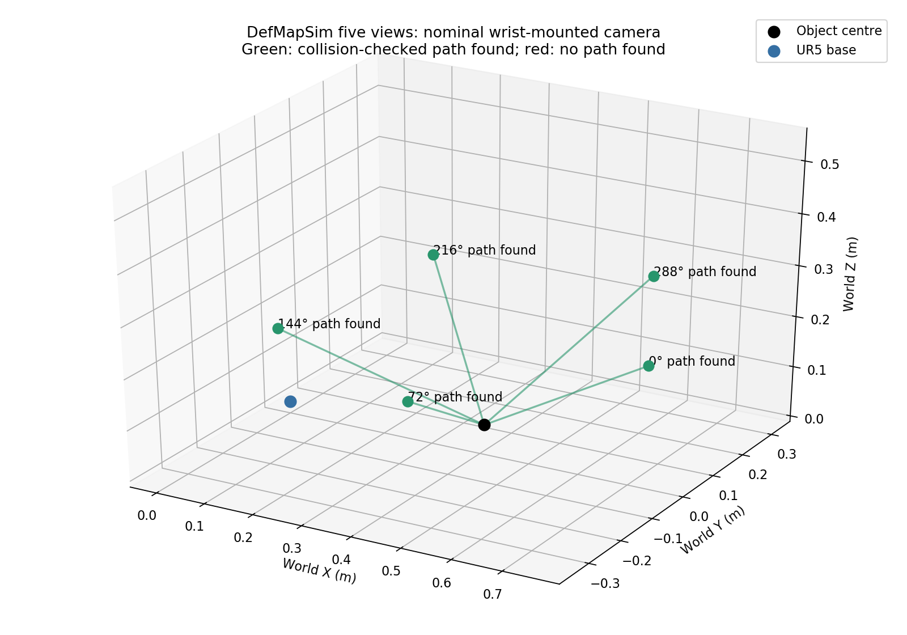

# Wrist-camera five-view feasibility — 2026-11-14

A collision-checked sequence was found from arm home through all five camera
poses **with fingers already folded and an assumed 6 cm lateral camera mount**.
This is a planning feasibility result, not a calibrated capture implementation.
No robot motion or image capture was executed. Production config and saved
trajectories were not changed.

## DefMapSim conventions reproduced

Sources inspected: `/home/chenfeng/DefMapSim/rigid_drop/depth_render.py`,
`rigid_drop/coordinates.py`, `rigid_drop/depth_processing.py`, and `config.yaml`.

- Orbit reference: 0.4 m from the recorded object center, 30° elevation,
  azimuths 0°, 72°, 144°, 216°, 288°.
- Depth/left-IR optical center: 0.035 m left of that reference, with the same
  orientation (not re-aimed independently at the object).
- Optical axes: +X right, +Y down, +Z forward.
- Drop-to-world rotation: `(x, y, z) -> (x, -z, y)`; drop +Y becomes world +Z.
  Drop +X is aligned with world +X for this assessment.
- Origin: current tofu mesh's convex-hull mass center in the configured world
  pose, approximately `[0.409563, -0.001482, 0.048959]` m. The current object/grasp
  Z offset of 0.015 m is included. UR5 mounting height is 0.012 m.

## Tested assumptions and results

| Camera mount / hand posture | Camera poses with paths | Object-center sightline |
|---|---:|---|
| Flange origin; fully open hand | 0/5 | Housing/palm block it |
| Flange origin; folded hand | 5/5 | Housing/palm block it |
| 6 cm along camera-right; folded hand | **5/5** | **Clear of hand geometry in all five views** |
| 6 cm along camera-left; folded hand | 5/5 | Housing blocks it |
| 10 cm along camera-right; folded hand | 4/5 | Clear; 144° pose collision-invalid in sampled solutions |

The open-hand case has mathematical IK solutions at all five views, but the
finger tips intersect the table. Changing only the arm branch cannot remove
that fixed hand-to-camera geometry. Folded means the configured `grasps2.json`
hand joint angles; exact values are included in each report.

The successful assumed optical-center position relative to `ra_flange` is
`[0, -0.06, 0]` m. The optical forward direction follows the flange-to-palm
vector, approximately `[0.994971, 0, 0.100165]` in flange coordinates. Optical
right is flange -Y; optical down is approximately `[0.100165, 0, -0.994971]`.
The report includes the complete 4×4 flange-to-optical transform.

## Successful camera targets

Coordinates are depth optical-center positions in ROS world metres. All views
retain DefMapSim's specified camera orientations, including image roll.
The path order is home → 0° → 72° → 144° → 216° → 288°, with the same folded
finger posture throughout. The startup finger-folding motion and return home
were not checked.

| Azimuth | X | Y | Z | Collision-free IK branches found | Incoming path found |
|---|---:|---:|---:|---:|---|
| 0° | 0.7560 | -0.0365 | 0.2490 | 4 | Yes |
| 72° | 0.4833 | -0.3418 | 0.2490 | 3 | Yes |
| 144° | 0.1087 | -0.1768 | 0.2490 | 1 | Yes |
| 216° | 0.1499 | 0.2304 | 0.2490 | 2 | Yes |
| 288° | 0.5499 | 0.3172 | 0.2490 | 3 | Yes |

Green lines show sightlines toward the object, not robot motion trajectories.

## Validation and limits

The checks ran in a Docker container with `--network none`, an isolated ROS
master, the project's combined UR5/Shadow model, and the configured open-world
table plus tofu collision mesh. Dummy controller endpoints reject all motion
requests; none were received. Hand-object, robot-table and self-collision
checking were enabled for this assessment, independently of replay settings.

For each target, 64 IK seeds were attempted with 0.04 s per seed; equivalent
solutions were deduplicated. MoveIt planned joint-space transitions between
selected valid configurations (4 s planning budget per candidate). These
transitions need not follow a circular camera orbit.

Visibility checks traced the ray to the object center through the hand's URDF
collision geometry. They do not certify the full object silhouette, full image
crop, stereo visibility, arm occlusion, or image quality. No camera housing,
mount bracket or cables are modeled. The exact physical mount transform and
geometry must be supplied before this becomes an executable capture task.
The 6 cm result is one feasible assumed optical-center placement, not an
optimized or physically validated mounting recommendation.

The real camera also needs the matching native intrinsics, depth-to-color
alignment and fixed `[96:396, 255:555]` crop used by DefMapSim. Reaching these
poses alone does not generate training-compatible images.

Machine-readable evidence:

- [Open hand, central mount](wrist_camera_report.json)
- [Folded hand, central mount](wrist_camera_folded.json)
- [Successful 6 cm side mount](wrist_camera_side_6cm.json)
- [Opposite-side 6 cm mount](wrist_camera_side_minus6cm.json)
- [10 cm side mount](wrist_camera_side_mount.json)
